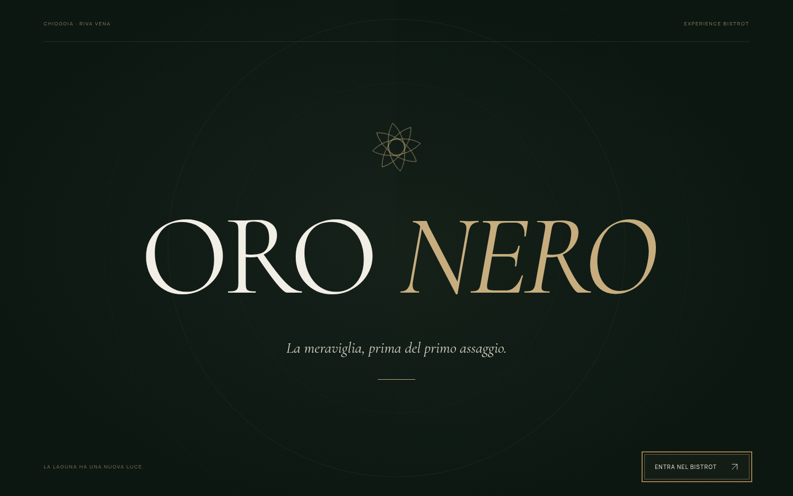

# Oro Nero 7.13 · Traduzione direttamente nel sito

- [Progetto completo 7.13](Oro-Nero-7.13-Traduzione-Integrata.zip): sorgenti, build, traduzioni locali e 99 test.
- [Build statica 7.13](Oro-Nero-7.13-Anteprima-statica.zip): contenuto compilato per hosting statico.
- [Homepage in inglese](Oro-Nero-7.13-Home-English-PC.png) · [Menu in tedesco sul telefono](Oro-Nero-7.13-Menu-Deutsch-mobile.png).

Il selettore cambia lingua nella stessa pagina, senza aprire la copia esterna di Google Translate. La lingua scelta rimane durante navigazione e ricaricamento; la musica continua sullo stesso lettore nei cambi interni.

**Lingue incluse: italiano, inglese, tedesco, francese e spagnolo.** Questa soluzione integrata sostituisce le precedenti 249 scelte esterne. Per altre lingue servono cataloghi aggiuntivi oppure un servizio configurato: non sono dichiarate disponibili traduzioni che non si possono verificare.

Quattro cataloghi locali con 498 chiavi ciascuno comprendono pagine pubbliche, 80 piatti e descrizioni attuali, allergeni, prenotazione, foto e comandi dinamici. La ricerca considera i nomi tradotti. Nessuna API, chiave o abbonamento. Prezzi e dati digitati preservati; l’admin resta in italiano e i nuovi testi senza traduzione conservano l’originale.

HTTP503 e caricamento pendente verificati: messaggio entro tre secondi, pagina utilizzabile, selettore chiudibile e nuovo tentativo possibile. **99 test superati**, oltre a controlli reali su desktop e telefono, senza richieste esterne o popup di traduzione.

**Questi download aggiornano GitHub. Pubblicare l’intera build 7.13 su Netlify per aggiornare il sito online; nessun deploy Netlify è stato eseguito.**

## Versione 7.12 · Menu al primo clic e animazioni su PC

- [Progetto completo 7.12](Oro-Nero-7.12-Menu-Animazioni.zip): sorgenti, build, 23 fotografie e 89 test.
- [Build statica 7.12](Oro-Nero-7.12-Anteprima-statica.zip): contenuto compilato per hosting statico.
- [Guarda l’intro animata su PC](Oro-Nero-7.12-Intro-PC.mp4): registrazione senza clic, con movimento ridotto di sistema attivo.
- [Menu al primo accesso da PC](Oro-Nero-7.12-Menu-PC.png) · [Menu al primo accesso da telefono](Oro-Nero-7.12-Menu-mobile.png).

Corretto il menu che perdeva la grafica nel passaggio dalla home e funzionava solo dopo il refresh. I CSS vengono preparati e applicati nell’ordine corretto, senza rimuovere o riavviare quelli comuni durante un fotogramma visibile. Verificati primo accesso, CSS rallentato, ricerca, ritorni e Indietro/Avanti a 390 e 1440 pixel: interfaccia completa dal primo fotogramma, 13 categorie e 80 voci, stesso lettore musicale in riproduzione.

Su richiesta del proprietario, intro, rotazione e lucciola restano animate anche quando il PC richiede movimento ridotto. Il logo nella testata ruota continuamente. La scelta riguarda gli effetti del marchio; gli altri effetti mantengono le rispettive regole di accessibilità. Avvio automatico senza clic, sequenza di circa 4,1 secondi.

Conservate tutte le 23 foto importate e la galleria nella home. **89 test superati** e due controlli browser indipendenti senza errori JavaScript.

**I download sono aggiornati su GitHub. Per aggiornare il sito online pubblicare l’intera build 7.12 su Netlify; nessun deploy Netlify è stato eseguito.**

## Versione 7.11 · Le tue foto nella home e desktop

- [Progetto completo 7.11](Oro-Nero-7.11-Foto-Home-Desktop.zip): sorgenti, build, 23 foto ottimizzate e 84 test.
- [Build statica 7.11](Oro-Nero-7.11-Anteprima-statica.zip): contenuto compilato per hosting statico.
- [Home mobile](Oro-Nero-7.11-Home-mobile.png) · [Home desktop](Oro-Nero-7.11-Home-desktop.png).
- [Galleria nella home su mobile](Oro-Nero-7.11-Galleria-mobile.png) · [Galleria nella home su desktop](Oro-Nero-7.11-Galleria-desktop.png).

Importati tutti i 13 ZIP più recenti: 26 immagini ricevute, 23 foto uniche dopo la rimozione di tre duplicati esatti. Le foto sostituiscono quelle iniziali nell’apertura, nella cucina, nelle proposte, nella cantina, nell’atmosfera e nelle immagini sociali.

La galleria è ora direttamente nella home, raggiungibile dalla navigazione. Mostra sei anteprime e il comando per tutte le 23 foto. Ingrandimento completo, contatore, frecce, Escape e gruppi distinti; la musica continua nei passaggi interni.

Da PC l’intro automatica compare anche con movimento ridotto, come breve logo statico. Con movimento normale restano rotazione e lucciola. Hero desktop a tutta larghezza, sfumatura coerente con il telefono e suggerimento spostato per lasciare spazio al lettore musicale. Verifiche locali fino a 1920 pixel e 84 test superati.

Gli ZIP contengono le versioni WebP ottimizzate; gli originali JPEG sono conservati nello staging dell’ambiente. `foto-sito.csv` associa ogni foto ai file ricevuti. Il menu pubblico resta senza fotografie.

**Questa pubblicazione aggiorna i download GitHub. Per vedere le modifiche sul sito online occorre pubblicare l’intera build 7.11 su Netlify. Nessun deploy Netlify è stato eseguito.**

## Versione 7.10 · Uno spazio dedicato alle foto

- [Progetto completo 7.10](Oro-Nero-7.10-Galleria-Fotografica.zip): sorgenti, build e 81 test.
- [Anteprima statica 7.10](Oro-Nero-7.10-Anteprima-statica.zip): file compilati per hosting statico.
- [Galleria su mobile](Oro-Nero-7.10-Galleria-mobile.png) · [Galleria su desktop](Oro-Nero-7.10-Galleria-desktop.png) · [Foto ingrandita](Oro-Nero-7.10-Galleria-zoom.png).

Pagina `/galleria/` dedicata alle fotografie, con accesso dalla navigazione, dal footer e dalla home. Griglia responsive nelle proporzioni originali; ingrandimento con foto completa, precedente/successiva, frecce da tastiera ed Escape. La musica continua durante la navigazione interna.

La galleria contiene per ora sei foto già presenti nel progetto. **Le nuove foto degli ZIP caricati non sono ancora importate:** gli archivi superano il limite di trasferimento di 32 MiB. Servono immagini singole o ZIP sotto i 32 MB per aggiungerle. Nessuna nuova fotografia è stata inventata.

Conservati sezioni storia e squadra, selettore di traduzione, intro automatica e menu senza foto. La galleria si modifica nei sorgenti; le istruzioni sono nel README del progetto completo.

Nessun deploy Netlify eseguito. Pubblicare l’intera build aggiornata sull’hosting per vedere le modifiche online.

## Versione 7.9 · Lingue, storia e squadra

- [Progetto completo 7.9](Oro-Nero-7.9-Lingue-Storia-Squadra.zip): sorgenti, build e 81 test.
- [Anteprima statica 7.9](Oro-Nero-7.9-Anteprima-statica.zip): file compilati per hosting statico.
- [Selettore delle lingue](Oro-Nero-7.9-Lingue-mobile.png) · [Squadra su mobile](Oro-Nero-7.9-Squadra-mobile.png) · [Squadra su desktop](Oro-Nero-7.9-Squadra-desktop.png).

Selettore nella testata e nel footer, con ricerca fra 249 lingue e varianti. Apre la pagina pubblica corrente tramite Google Translate in una nuova scheda; la pagina originale resta in italiano. Non richiede chiavi o abbonamenti. La copertura dipende dal servizio e non comprende letteralmente tutte le lingue del mondo. L’anteprima locale e l’area amministrativa non vengono inviate a Google. La navigazione è verificata con destinazione simulata; la traduzione remota e la resa dei contenuti dinamici devono essere verificate sul dominio pubblicato.

Home con “La nostra storia” e “La squadra”: Chef, Aiuto chef, Sala e Accoglienza. I testi usano l’identità già presente nel progetto; nomi, fotografie, anno di apertura e biografie reali non sono stati inventati e restano da personalizzare.

81 test superati e controlli browser da 320 a 1440 pixel, incluse navigazione e intro automatica. Conservati sottofondo discreto e continuo, marchio rotante, intro senza clic e menu senza foto.

Nessun deploy Netlify eseguito. Pubblicare l’intera build aggiornata sull’hosting per vedere le modifiche online.

## Versione 7.8 · Intro automatica, senza clic

- [Progetto completo 7.8](Oro-Nero-7.8-Intro-Automatica.zip): sorgenti, build e 73 test.
- [Anteprima statica 7.8](Oro-Nero-7.8-Anteprima-statica.zip): file compilati per hosting statico.

L’intro parte da sola a ogni apertura completa o ricaricamento della homepage. Non richiede clic sul logo, sulla freccia o su “Rivivi l’ingresso”; non viene bloccata dalla musica o dai vecchi indicatori di visita salvati nella sessione. Tornando alla home tramite navigazione interna, l’animazione non si ripete automaticamente.

La freccia salta sempre l’intro. × ed Escape entrano senza musica. Conservati marchio nitido, grafica rifinita, sottofondo discreto e menu senza foto. L’autoplay sonoro viene tentato separatamente e resta soggetto alle regole del browser.

Nessun deploy Netlify eseguito. Pubblicare l’intera build aggiornata sull’hosting per vedere le modifiche online.

## Versione 7.7 · Marchio nitido e ingresso rifinito

- [Guarda la nuova intro](Oro-Nero-7.7-Intro.mp4).
- [Progetto completo 7.7](Oro-Nero-7.7-Marchio-Intro.zip): sorgenti, build, nuovo emblema e 68 test.
- [Anteprima statica 7.7](Oro-Nero-7.7-Anteprima-statica.zip): file compilati per hosting statico.
- [Nuovo marchio nel footer](Oro-Nero-7.7-Marchio-footer.png) · [Homepage mobile](Oro-Nero-7.7-Home-mobile.png) · [Emblema PNG trasparente](Oro-Nero-7.7-Emblema.png).

Emblema ripulito ad alta risoluzione, senza ingrandire il piccolo logo precedente. Intro con marchio leggibile, rotazione morbida, alone discreto e una sola lucciola con scia sottile; apertura più soffusa. Piè di pagina coordinato con nome nitido composto in HTML e testo più leggibile.

Conservati solo emblema rotante nella testata, titoli compatti, musica discreta e continua, ingresso sincronizzato e menu senza foto. Il permesso di autoplay resta sotto il controllo del browser. Video e schermate sono anteprime della build, non un deploy del sito.

Nessun deploy Netlify eseguito. Pubblicare l’intera build aggiornata sull’hosting per vedere le modifiche online.

## Versione 7.6 · Logo, titoli e ingresso con musica

- [Progetto completo 7.6](Oro-Nero-7.6-Logo-Titoli-Intro.zip): sorgenti, build e 68 test.
- [Anteprima statica 7.6](Oro-Nero-7.6-Anteprima-statica.zip): file compilati per hosting statico.
- [Anteprima mobile della homepage](Oro-Nero-7.6-Home-mobile.png).

In alto compare soltanto l’emblema in lenta rotazione, senza scritte accanto. Il titolo è “Sapori di laguna, emozioni da vivere.”; anche gli altri titoli scorrono naturalmente senza interruzioni forzate.

Con autoplay consentito la musica avvia l’intro automaticamente. Se il browser chiede un gesto, un tocco sul logo o sulla freccia avvia musica e animazione insieme, prima della homepage. × ed Escape entrano senza musica. Conservati sottofondo discreto, continuità tra le pagine, menu senza foto e primo ingresso senza lampo della home.

Nessun deploy Netlify eseguito. Pubblicare l’intera build aggiornata sull’hosting per vedere queste modifiche sul sito online.

## Versione 7.5 · Sottofondo discreto e primo ingresso

- [Progetto completo 7.5](Oro-Nero-7.5-Sottofondo-Intro.zip): sorgenti, build, MP3 più basso e 62 test.
- [Anteprima statica 7.5](Oro-Nero-7.5-Anteprima-statica.zip): file compilati per hosting statico.

Musica resa più discreta direttamente nel file audio, con un’ulteriore regolazione del lettore. L’avvio viene tentato prima del caricamento degli altri moduli; quando il browser richiede un gesto, basta una normale interazione con il sito, senza usare il pulsante musicale.

Eliminato il lampo della homepage prima dell’intro: la copertura iniziale è presente dal primo disegno. Skip ed Escape funzionano anche prima del caricamento completo; un eventuale errore non lascia il sito bloccato.

Conservati musica continua tra le pagine, logo e lucciola, sincronizzazione dell’intro e menu senza foto. L’autoplay sonoro resta soggetto alle regole del browser. Nessun deploy Netlify eseguito: pubblicare i nuovi file sull’hosting per aggiornare il sito online.

## Versione 7.4 · Intro sincronizzata alla musica

- [Progetto completo 7.4](Oro-Nero-7.4-Intro-Musica-Sincronizzata.zip): sorgenti, build, MP3 e 53 test.
- [Anteprima statica 7.4](Oro-Nero-7.4-Anteprima-statica.zip): file compilati per hosting statico.

Corretto il caso in cui l’intro terminava prima che l’MP3 avesse caricato. Ora, durante il caricamento, il logo resta piccolo; rotazione, ingrandimento e lucciola iniziano quando il lettore è realmente in riproduzione. L’attesa massima è di otto secondi e si può sempre saltare. Blocco autoplay, pausa ed errore fanno proseguire l’intro senza attesa.

Musica continua fra le pagine, volume al 100% e menu senza foto conservati. La correzione non scavalca i blocchi autoplay dei browser. Nessun deploy Netlify eseguito: gli ZIP aggiornati vanno pubblicati sull’hosting per modificare il sito online.

## Versione 7.3 · Musica continua e automatica

- **[Progetto completo 7.3](Oro-Nero-7.3-Musica-Continua.zip)**: sorgenti, sito compilato, 44 test e guida Netlify.
- [Anteprima statica 7.3](Oro-Nero-7.3-Anteprima-statica.zip): file pronti per hosting statico.

La musica continua sullo stesso lettore passando tra tutte le pagine interne, compresi menu, recensioni, allergeni, privacy, QR e admin, e usando avanti/indietro. Il nuovo estratto di Vivaldi dura circa 6 minuti e 26 secondi, è normalizzato e riprodotto al 100% del volume del lettore. Il sito tenta l’avvio automatico sonoro; se il browser lo blocca, basta la prima interazione sul sito. Il comando pausa rimane disponibile e la scelta viene rispettata.

Il menu resta testuale, senza fotografie o segnaposti. L’intro conserva solo l’emblema del logo, che ruota e si ingrandisce; una lucciola apre il sito. Verificati 44 test e la continuità audio in Chromium, anche su smartphone, senza errori JavaScript nelle pagine provate.

Un ricaricamento completo, una nuova scheda e l’uscita dal sito seguono le regole audio del browser. Le nuove fotografie restano in attesa di file singoli o ZIP sotto 32 MiB.

Per l’admin persistente occorre il deploy completo descritto nella guida. **Nessun deploy Netlify è stato eseguito.** GitHub rende disponibili i download e non pubblica automaticamente il sito su Netlify.

---

# Versione 7.2 · Logo, lucciola e musica

- [Progetto completo 7.2](Oro-Nero-7.2-Logo-Lucciola-Musica.zip): sorgenti, build statica, test e guida Netlify.
- [Anteprima statica 7.2](Oro-Nero-7.2-Anteprima-statica.zip): file pronti per hosting statico.

Il menu è un elenco senza fotografie né segnaposti, con nomi, descrizioni, prezzi e allergeni. Anche la sua testata è senza foto.

L’intro mostra solo l’emblema del logo: parte piccolo, ruota e si ingrandisce, poi una lucciola dorata apre il sito. L’inverno di Vivaldi, fornito dall’utente, è disponibile su tutte le pagine con avvio/pausa. La musica parte dopo un’interazione consentita dal browser; preferenza e posizione vengono conservate nella sessione. La navigazione tra pagine può interrompere brevemente l’audio e richiedere un nuovo tocco.

Le nuove foto non sono ancora incluse: tutti gli ZIP ricevuti superano il limite di trasferimento di 32 MiB. Sono necessari file singoli o archivi più piccoli per aggiungerle progressivamente. Le fotografie già presenti sono mantenute.

Per l’admin persistente occorre il deploy completo Netlify descritto nel progetto. Nessun deploy è stato eseguito con questa modifica.

## Versione 7.1 · Menu fotografico e ingresso scenografico

## Scarica la versione aggiornata

- **[Progetto completo 7.1](https://github.com/GiaMMark/GiaMMark/raw/refs/heads/main/downloads/Oro-Nero-7.1-Menu-Fotografico.zip)**: sorgenti, sito compilato, 30 test, guida Netlify e catalogo fotografico da completare.
- [Anteprima statica 7.1](https://github.com/GiaMMark/GiaMMark/raw/refs/heads/main/downloads/Oro-Nero-7.1-Anteprima-statica.zip): solo i file compilati, senza upload e salvataggio amministrativo.

L’ingresso della homepage disegna l’emblema dorato, rivela il nome Oro Nero e apre il sipario sulla fotografia. È saltabile e ripetibile; non rallenta l’accesso diretto al menu tramite QR.

Ogni voce del menu ha una scheda visiva. Puoi associare foto reali dal dispositivo oppure tramite URL e ingrandirle nel menu pubblico. **Attualmente è associata la foto del crudo; le altre 79 voci mostrano “Foto in arrivo”.** Servono gli scatti del ristorante per completare le fotografie. Nello ZIP trovi `FOTO_PIATTI.md` e `foto-piatti.csv`.

## Anteprime

[Ingresso Oro Nero](Oro-Nero-7.1-Ingresso.png) · [Schede del menu](Oro-Nero-7.1-Menu.png)

## Pubblicazione del sito

Per il sito completo con area amministrativa e caricamento foto, segui `README_NETLIFY.md` nello ZIP principale. Il caricamento su GitHub rende disponibili i file e non pubblica automaticamente il sito su Netlify. Nessun deploy Netlify è stato eseguito durante questa consegna.

## Versione precedente

- [Progetto completo 7.0](https://github.com/GiaMMark/GiaMMark/raw/refs/heads/main/downloads/Oro-Nero-7-Laguna-Nocturne.zip)
- [Anteprima statica 7.0](https://github.com/GiaMMark/GiaMMark/raw/refs/heads/main/downloads/Oro-Nero-7-Anteprima-statica.zip)
