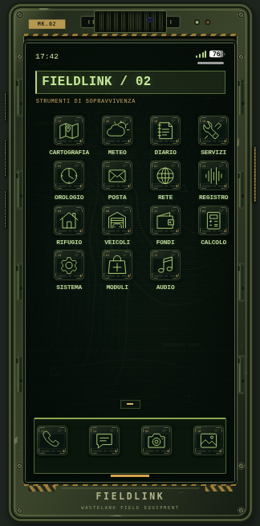

# FIELDLINK MK.II — Wasteland Edition

Interfaccia survival per il pacchetto LB Phone 2.9.0 fornito: scocca usurata, display incassato verde fosforo, icone industriali e app con pannelli da terminale.

## Download

- [Pacchetto completo](https://github.com/GiaMMark/GiaMMark/raw/refs/heads/survival-phone-v2/downloads/fieldlink-v2/lb-phone-survival-v2-wasteland.zip)
- [Solo tema](https://github.com/GiaMMark/GiaMMark/raw/refs/heads/survival-phone-v2/downloads/fieldlink-v2/lb-phone-survival-v2-solo-tema.zip)
- [Istruzioni di installazione e ripristino](LEGGIMI-SURVIVAL-v2.md)
- [Checksum SHA-256](SHA256SUMS.txt)

I pacchetti includono istruzioni, anteprime e backup dei file originali modificati. Mantieni il nome della risorsa `lb-phone` e riavviala dopo l'installazione. Se hai configurazioni personalizzate, segui le istruzioni per integrare solo il tema.

## Verifica

Interfaccia provata in Chromium: sblocco, home, Sistema, Contatti, Diario, Messaggi e griglia da 24 app alle scale 0.55, 0.7 e 0.9. Le funzioni di gioco richiedono una prova sul server FiveM con le dipendenze originali. Non aggiunge meccaniche survival al server.
