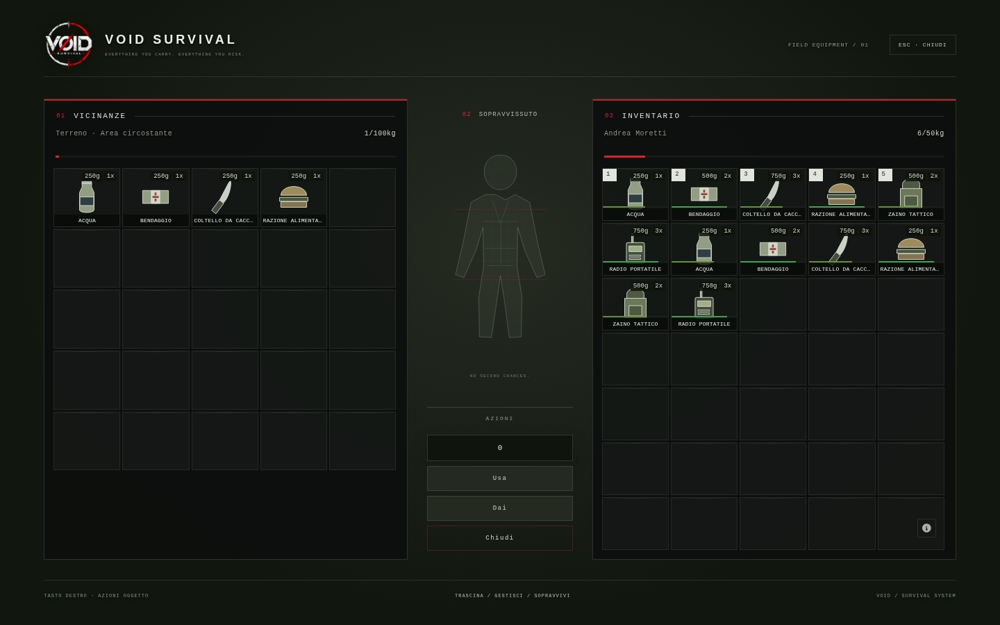

# VOID Survival · Inventario

Restyling ispirato alle interfacce survival di DayZ, basato sull'`ox_inventory` 2.45.0 caricato in questa conversazione. La grafica usa nero, toni militari neutri e accenti rossi, con il logo VOID Survival.



## Installazione della patch

1. Conserva una copia della tua resource `ox_inventory` funzionante.
2. Ferma `ox_inventory` prima di aggiornare i file, poi sovrapponi la cartella `ox_inventory` dello ZIP alla resource esistente. Mantieni esattamente il nome della resource.
3. La patch contiene il manifest e la nuova interfaccia. Non sostituire `data/items.lua`, i moduli Lua, le configurazioni del server o le immagini degli oggetti con quelli di un'altra installazione.
4. Riavvia la resource durante la manutenzione e riconnettiti per verificare il caricamento della nuova UI. Non occorre importare SQL aggiuntivo per questo restyling.

La patch è preparata per i bundle dell'archivio fornito: `index-7c4ea07a.js` e `index-9aba2ab3.css`. Se la tua installazione usa file frontend con nomi o versioni diversi, verifica prima il manifest e `web/build/index.html` su una copia di sviluppo. Non rinominare semplicemente bundle incompatibili.

## Configurazione grafica

Modifica **`web/build/void-config.js`** per il nome, il sottotitolo, il logo, il colore di accento e le etichette delle sezioni.

```js
window.VOID_INVENTORY = {
  brand: 'VOID SURVIVAL',
  subtitle: 'EVERYTHING YOU CARRY. EVERYTHING YOU RISK.',
  logo: 'assets/void-logo.png',
  accent: '#d5272f',
  labels: { vicinity: 'VICINANZE', inventory: 'INVENTARIO', survivor: 'SOPRAVVISSUTO' }
};
```

Le altre etichette usano i valori predefiniti se non configurate. Sono accettati colori `#RRGGBB` e un logo PNG nella cartella locale `assets/`. La UI non usa font remoti o CDN. Il resto delle traduzioni dei pulsanti e dei menu continua a provenire dalla localizzazione originale di ox_inventory; usa la lingua italiana nella configurazione ox_lib del tuo server se desideri `Usa`, `Dai` e `Chiudi`.

## Comportamento conservato

- A sinistra compare il contenitore esterno effettivamente aperto: terreno, stash, negozio o altro inventario previsto dal tuo stack.
- A destra compare l'inventario personale effettivo. Peso, quantità, durabilità, descrizioni, metadati, slot e regole vengono sempre da ox_inventory.
- Al centro rimangono i comandi nativi di quantità, utilizzo, consegna e chiusura. La silhouette è decorativa e non rappresenta uno stato di equipaggiamento o un ped 3D.
- Trascinamento, trasferimenti, divisione delle quantità, menu contestuali e hotbar continuano a essere gestiti dal bundle originale.

Si tratta di un'ispirazione **visiva** DayZ: non introduce oggetti di dimensioni multiple, rotazione, equipaggiamento a sagoma o nuovi contenitori. Il sistema rimane quello a slot di ox_inventory, senza una seconda logica inventario parallela.

Il JavaScript React compilato e il CSS originali restano identici all'archivio fornito. La personalizzazione è aggiunta da `assets/void-survival.css` e `assets/void-survival.js`, caricati dopo il CSS originario. Il tema ripristina anche la visibilità dei tooltip che il precedente layer grafico URBS aveva nascosto.

## Immagini degli oggetti

L'archivio caricato non contiene `web/images/`. La patch non cancella né sostituisce le immagini della tua installazione: conserva la cartella che usi già. Se un'immagine è assente, il relativo oggetto mantiene nome, quantità, peso e operazioni; la casella può apparire senza icona. Usa le immagini dei tuoi oggetti con i nomi attesi da ox_inventory o il percorso immagini già configurato nel server.

Le immagini schematiche degli oggetti eventualmente visibili nell'anteprima sono fixture del test browser: non vengono inserite nell'inventario del giocatore e non alterano la lista oggetti del server.

## Verifiche

La UI viene verificata in Chromium usando il **bundle originale** e i messaggi NUI reali `init`, `setupInventory`, `refreshSlots` e `closeInventory`, con risposte simulate del server. I controlli comprendono menu contestuali, quantità, trasferimento tramite trascinamento, tooltip, aggiornamento degli slot, chiusura e layout desktop.

Il test browser non sostituisce il collaudo su FXServer. Prima di aprire al pubblico verifica sul tuo server trasferimenti con peso limite, stash, negozi, crafting, metadati, hotbar e visibilità dopo l'apertura/chiusura. Le native FiveM, le autorizzazioni e la persistenza del database restano responsabilità della tua installazione ox_inventory.

La licenza originale è conservata in `LICENSE`; anche le licenze del bundle sono conservate. Nessun cambio al branding modifica i diritti o l'attribuzione di ox_inventory.
